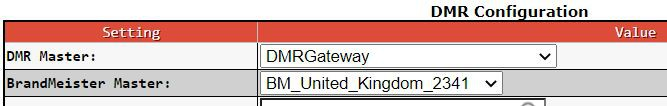

# Linking to Gateway Dynamic Talk Groups V10

!!! info "Source"
    Originally published by Norman Williams on hamradiosouthernrepeaters.co.uk. [Original PDF](../originals/images/PDF/Linking_to_Gateway_Dynamic_Talk_Groups.pdf) · [Source](https://hamradiosouthernrepeaters.co.uk/images/PDF/Linking_to_Gateway_Dynamic_Talk_Groups.pdf) Hub item 121.

In this example we will show Slot 2. Time Slot 2 implements the use of Gateway Dynamic Talk Groups.

The way to use the Gateway Dynamic Talk Groups is to program the radio with TG 9 on Time Slot 2 (add 9 in contacts as a Group Call, make a channel up for TG9 and add it to a Zone). This is the only Talk Group you will need for a QSO on the Dynamic Talk Groups.

## To link and unlink the Gateway Dynamic Talk Groups

### To link

**Option 1: manual dial**

Do a manual dial:

- **Menu → Contact → Manual Dial** → enter Talk Group number 2350, 3100, 91 → transmit for 1 second, or
- **Menu → Talk Group → Manual Dial** → enter Talk Group number 2350, 3100, 91 → transmit for 1 second.

The repeater will respond with a voice announcement, "Linked to 2350". Then go back to Talk Group 9 to make a QSO.

**Option 2: contacts**

Program the radio with the Talk Groups as Group Call in contacts.

To link to a Gateway Dynamic Talk Group, select the Talk Group number from the contacts list and transmit for about 1 second. The repeater will respond with a voice announcement, "Linked to 235x". Then go back to Talk Group 9 to make a QSO.

### To unlink

Select 4000 Private Call or Group Call from the contacts list and transmit for about 1 second. The repeater will respond with a voice announcement, "Not Linked".

### Get status

To enquire about the Talk Group linked, call 5000 Private Call or Group Call, and the repeater will respond with the currently linked Talk Group.

### Echo/Parrot

Call 9990 Private Call or Group Call, and the Echo/Parrot will respond back to you only.

!!! tip
    You will want your Hang Time for Private Call set to around 3, 5 or 7 seconds. This will drop the radio from Private Call back to Group Call for Channel TG9.

Some repeaters could offer this on Slot 1 or both.

## How to set up on a repeater or hotspot

You will need Pi-Star V4 or newer.

1. Set your Pi-Star up for BrandMeister DMRGateway.

    

    *Pi-Star DMR Configuration: DMR Master = DMRGateway, BrandMeister Master = BM_United_Kingdom_2341.*

2. Then go to **Configuration → Expert → Full Edit: DMR GW**.

    !!! warning
        Back up your Pi-Star before making any changes!

Then go to this section:

```ini
[DMR Network 1]
Enabled=1
Address=51.68.220.36
Port=62031
TGRewrite0=2,9,2,9,1
PCRewrite0=2,94000,2,4000,1001
TypeRewrite0=2,9990,2,9990
SrcRewrite0=2,4000,2,9,1001
PassAllPC0=1
PassAllTG0=1
PassAllPC1=2
PassAllTG1=2
Password="passw0rd"
Debug=0
Id=YOUR ID NUMBER
Name=BM_United_Kingdom_2341
```

We need to change all this section to:

```ini
[DMR Network 1]
Enabled=1
Address=51.68.220.36
Port=62031
TypeRewrite=2,9990,2,9990
TGDynRewrite=2,91,4000,5000,9,999908,234999,9990
PassAllPC=2
PassAllPC0=1
PassAllTG1=1
Password="passw0rd"     #Use your password if set in Selfcare
Debug=0
Id=YOUR ID NUMBER
Name=BM_United_Kingdom_2341
```

This will let you use TG 91 to 999999 via Gateway Dynamic Talk Groups on Slot 2, and normal Talk Groups via Slot 1 on a repeater or duplex hotspot.

You could have it on both Slots 1 & 2 (repeaters and duplex hotspots):

```ini
[DMR Network 1]
Enabled=1
Address=51.68.220.36
Port=62031
TypeRewrite0=1,9990,2,9990
TypeRewrite1=2,9990,2,9990
TGDynRewrite0=1,91,4000,5000,9,999908,234999,9990
TGDynRewrite1=2,91,4000,5000,9,999908,234999,9990
PassAllPC0=1
PassAllPC1=2
Password="passw0rd"     #Use your password if set in Selfcare
Debug=0
Id=YOUR ID NUMBER
Name=BM_United_Kingdom_2341
```

This will let you use TG 91 to 999999 via Gateway Dynamic Talk Groups on Slot 1 & 2.

## Information

`TGDynRewrite=2,91,4000,5000,9,999908,234999,9990`

| Value | Meaning |
|---|---|
| 2 | Slot 2 |
| 91 | Start Talk Group in the range you wish to use |
| 4000 | Include to get spoken confirmation back via TG 9 |
| 5000 | Include for information to be spoken back via TG 9 |
| 9 | Pass all Gateway Dynamic Talk Groups to TG 9 |
| 999908 | End Talk Group in the range you wish to use (91 + 999908 = 999999) |
| 234999 | Ignore so APRS will be passed |
| 9990 | Ignore so Echo is passed back to sender only and not TG 9 |

So this takes us from TG 91 to 999999 via TG 9.

- All Talk Groups below 90 will not be passed to TG 9 and work as normal.
- 7 digit ID Private Calls will not be passed to TG 9.

To include 7 digit IDs as Talk Groups we add an extra 9:

`TGDynRewrite=2,91,4000,5000,9,9999089,234999,9990`

!!! warning
    When using this you can no longer do Private Calls to other users.

This system is still being developed. You can follow on this link: <https://groups.io/g/OpenDV/search?ev=0&q=dynamic>

## Notes

If you change anything in **Configuration** or **Expert**, you will have to go back to **Full Edit: DMR GW** and apply the above settings again.

When using **Configuration → DMRGateway**, only edit or make changes in **Full Edit: DMR GW**.

## See also

- [Dynamic and Static Talkgroups on Brandmeister v2](dynamic-talkgroup-and-static-talkgroup-on-brandmeister.md)
