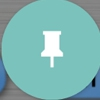
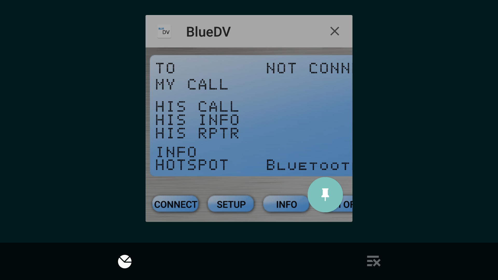

# Lock your phone to a single app – BlueDV

!!! info "Source"
    Originally published by Norman Williams on hamradiosouthernrepeaters.co.uk. [Original PDF](../originals/images/PDF/Lock-your-phone-to-a-single-app--BlueDV.pdf) · [Source](https://hamradiosouthernrepeaters.co.uk/images/PDF/Lock-your-phone-to-a-single-app--BlueDV.pdf)

This will keep your BlueDV app on top and prevent it being closed down.

On an Android phone 5.0 or later, go to **Settings → General → Security → Pin Windows** (or Screen Pinning) and turn it on. Now come out.

1. Make sure your Bluetooth is turned on.
2. Start the BlueDV app.
3. Tap the **Overview** button (the square button in the lower right corner). Some phones require the **Back** tab first and then the square.

    

4. You will now see a pin icon  in the bottom right of BlueDV.
5. Tap the pin icon on the BlueDV app and then tap **Start**. Now BlueDV is pinned to your phone and cannot be moved away from.

    

6. To unpin the app, or take a phone call etc, hold down the **Back** and **Overview** buttons at the same time for a second or two, until your phone tells you that it has unpinned the screen.

    

By M6NBP – 19th January 2017

## See also

- [Lock your Tablet to a single app – BlueDV](lock-your-tablet-to-a-single-app-bluedv.md)
- [BlueDV Android App locked to Screen](bluedv-android-app-locked-to-screen.md)
