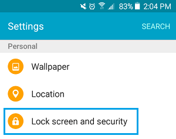
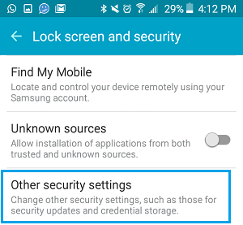
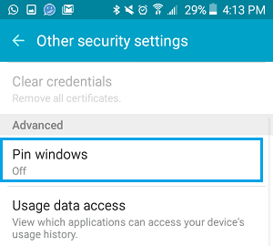
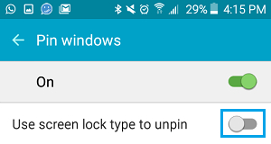
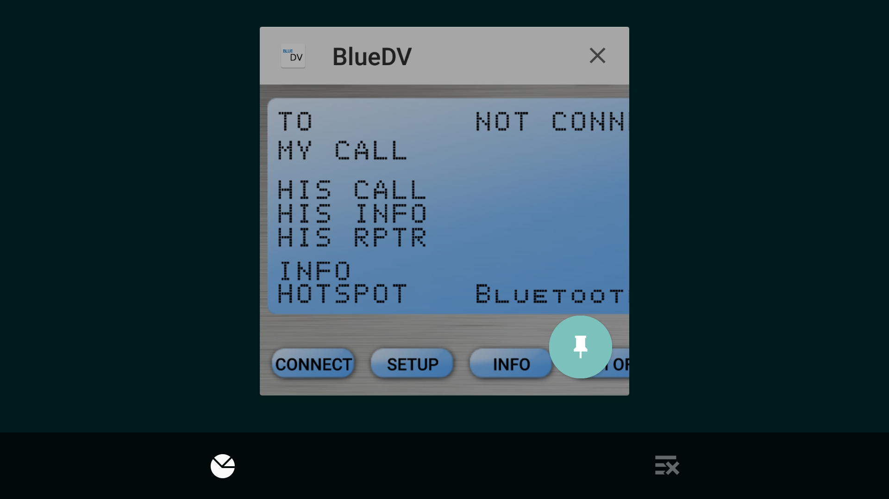

# Lock your Tablet to a single app – BlueDV

!!! info "Source"
    Originally published by Norman Williams on hamradiosouthernrepeaters.co.uk. [Original PDF](../originals/images/PDF/Lock-your-Tablet-to-a-single-app--BlueDV.pdf) · [Source](https://hamradiosouthernrepeaters.co.uk/images/PDF/Lock-your-Tablet-to-a-single-app--BlueDV.pdf)

This will keep your BlueDv app on top and prevent it being closed down.

## Setup Screen Pinning Mode On Android Tablet 5.0 or latter

1. Open the Settings on your Android tablet
2. Next, tap on Security
    (This appears as Lock Screen and Security on Samsung Devices)

    

3. If you are using a Samsung Phone or Tablet, you need to tap on Other Security Settings option, otherwise skip to step #4 below.

    

4. Next, tap on Screen Pinning (or Pin Windows in case of a Samsung device).

    

5. On the next screen, turn on the feature.

    

    *Pin windows = On; Use screen lock type to unpin = Off.*

## Lock Android Tablet to BlueDv App

Once you have finished setting up the screen pinning.

1. Open the BlueDv App
2. Next, tap on the Recent Apps button located at the bottom of your device.

    

3. Next tap on the Pin icon, located near the bottom right corner.

    

4. You will see an Enable Pin Windows popup, prompting you to either Start or Cancel Pin Mode. Tap on Start to start screen pinning mode on your device.

## To Unpin the app or take a Phone Call etc

1. Hold down the Back and Overview buttons at the same time for a second or two, until your phone tells you that it has unpinned the screen.

    

By M6NBP - 19th January 2017
