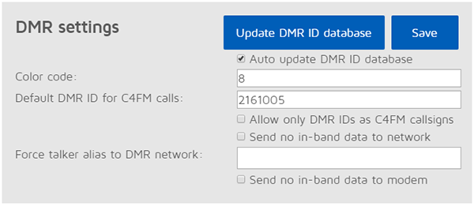

# OpenSpot sending APRS and Talker Alias

!!! info "Source"
    Originally published by Norman Williams on hamradiosouthernrepeaters.co.uk. [Original PDF](../originals/images/Anytone/OpenSpot_sending_APRS_and_Talker_Alias.pdf) · [Source](https://hamradiosouthernrepeaters.co.uk/images/Anytone/OpenSpot_sending_APRS_and_Talker_Alias.pdf) Hub item 72.

**Make sure all three boxes are unticked:**

- Allow only DMR IDs as C4FM
- Send no in-band data to network
- Send no in-band data to modem

## DMR settings

*DMR settings: Auto update DMR ID database ticked; Color code 8; Default DMR ID for C4FM calls 2161005; Allow only DMR IDs as C4FM callsigns, Send no in-band data to network and Send no in-band data to modem all unticked; Force talker alias to DMR network blank.*

- **Send no in-band data to network:** if you enable this, in-band data coming from your radio like talker alias or in-band GPS position information won’t be sent to the network.
- **Force talker alias to DMR network:** this talker alias will be sent for all calls coming from your radio (if your radio is already sending a talker alias to openSPOT, this setting will overwrite that).
- **Send no in-band data to modem:** if your radio has issues decoding voice calls containing in-band data like talker alias or in-band GPS position information, enable this setting. This will filter all in-band data for calls coming from the network. By default this setting is enabled – if you have a radio which supports talker alias decoding (like Hyteras with at least v8 firmwares), turn off this setting to let openSPOT pass through in-band data to your radio.

*Info taken from User Manual.*

[Setting Up DMR APRS – D868/878/578 Radio](../aprs-gps/digital-aprs-settings-d868-anytone.md)
