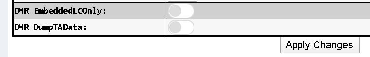

# Pi-Star sending APRS and Talker Alias

!!! info "Source"
    Originally published by Norman Williams on hamradiosouthernrepeaters.co.uk. [Original PDF](../originals/images/Anytone/Pi-Star_sending_APRS_and_Talker_Alias.pdf) · [Source](https://hamradiosouthernrepeaters.co.uk/images/Anytone/Pi-Star_sending_APRS_and_Talker_Alias.pdf) Hub item 74.

In Pi-Star, under **Configuration → DMR Configuration**, make sure both of these are turned off:

| Setting | Value |
|---|---|
| DMR EmbeddedLCOnly | Off |
| DMR DumpTAData | Off |

*Pi-Star DMR Configuration: DMR EmbeddedLCOnly = off, DMR DumpTAData = off.*

See also: [Setting Up DMR APRS – D868/878/578 Radio](../aprs-gps/digital-aprs-settings-d868-anytone.md)
