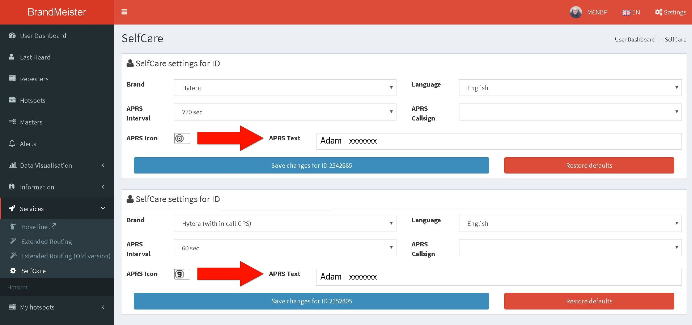

# Sending APRS Text & Talker Alias

!!! info "Source"
    Originally published by Norman Williams on hamradiosouthernrepeaters.co.uk. [Original PDF](../originals/images/PDF/Sending-Talker-Alias.pdf) · [Source](https://hamradiosouthernrepeaters.co.uk/images/PDF/Sending-Talker-Alias.pdf)

Go to SelfCare and log in

<https://brandmeister.network/?page=selfcare>

Set the Brand of your Radio (MD380 is Chinese)

All we need to do is change the APRS Text

Most common is
Your name (Adam)
*(BM sends your Callsign now)*

You can enter up to 14 characters/spaces.
Adam Smith UK = (14)

*SelfCare settings for two IDs: Brand = Hytera (APRS Interval 270 sec) and Hytera (with in call GPS) (APRS Interval 60 sec), Language = English, APRS Text = "Adam xxxxxxx".*

Does not work (yet)

- Motorola Repeaters (possible, but it has issues with decoding audio streams)

Does not work (no possibilities)

- c-Bridge CC-CC Link (protocol limitation)
- RadioActivity KAIROS (protocol limitation)
- DV4\*

[Full info and updates on this link](https://wiki.brandmeister.network/index.php/Talker_Alias)
