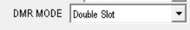
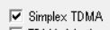

# Anytone DMR Simplex UK v2

!!! info "Source"
    Originally published by Norman Williams on hamradiosouthernrepeaters.co.uk. [Original PDF](../originals/images/Anytone/Anytone_DMR_Simplex_UK.pdf) · [Source](https://hamradiosouthernrepeaters.co.uk/images/Anytone/Anytone_DMR_Simplex_UK.pdf) Hub item 51.

## Anytone radio settings for each channel

*Channel: DMR MODE = Double Slot; Simplex TDMA ticked.*

| Setting | Value |
|---|---|
| Time Slot | 1 |
| Color Code | 1 |
| Talk Group | 9 (USA, Canada, EU etc use Talk Group 99) |

## UHF / VHF DV simplex

DMR Time Slot 1, Colour Code 1, Talk Group 9. The time slot, color code and talk group are based on what's in the majority of code plugs.

| UHF | VHF |
|---|---|
| DH1 438.5875 Sussex Simplex | DV1 144.5875 Sussex Simplex |
| DH2 438.6000 | DV2 144.6000 |
| DH3 438.6125 (DV calling channel) | DV3 144.6125 (DV calling channel) |
| DH4 438.6250 | DV4 144.6250 |
| DH5 438.6375 | DV5 144.6375 |
| DH6 438.6500 | DV6 144.6500 |
| DH7 438.6625 | DV7 144.6625 |
| DH8 438.6750 | DV8 144.6750 |
| | V16 to V19 |
| U273 to U279 | V21 to V39 |
| U281 to U286 | V41 to V47 |

[Simplex Channel Frequency](simplex-channel-frequency.md)
