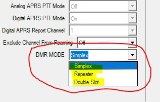

# DMR MODE

!!! info "Source"
    Originally published by Norman Williams on hamradiosouthernrepeaters.co.uk. [Original PDF](../originals/images/Anytone/DMR-MODE.pdf) · [Source](https://hamradiosouthernrepeaters.co.uk/images/Anytone/DMR-MODE.pdf) Hub item 96.

*DMR MODE drop-down options: Simplex (selected), Repeater, Double Slot.*

| No | DMR MODE | Meaning |
|---|---|---|
| 1 | Simplex | DMR Tier I (TX/RX on both slots at same time) |
| 2 | Repeater | DMR Tier II (TX/RX on Slot 1 or Slot 2) |
| 3 | Double Slot | Simplex DMR Tier II (TX/RX on Slot 1 or Slot 2) |

## Which to use

- **Ham radio DMR simplex frequencies:** we would use Simplex = No 1. [UK Simplex Frequencies Link](simplex-channel-frequency.md)
- **Ham radio DMR repeaters:** we would use split frequencies, Repeater = No 2.
- **Ham radio doing events:** we would use Double Slot = No 3. This lets us have two channels on the same frequency: Slot 1 and Slot 2.
- **Business users on simplex frequencies:** you should use Double Slot = No 3. This lets us have two channels on the same frequency: Slot 1 and Slot 2.
