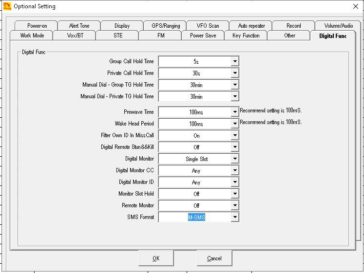

# DMR Text Message on BrandMeister

!!! info "Source"
    Originally published by Norman Williams on hamradiosouthernrepeaters.co.uk. [Original PDF](../originals/images/Anytone/DMR_Text_Message_on_BrandMeister.pdf) · [Source](https://hamradiosouthernrepeaters.co.uk/images/Anytone/DMR_Text_Message_on_BrandMeister.pdf) Hub item 123 and 123a.

[Online Text Message](http://www.findu.com/cgi-bin/entermsg.cgi?fromcall=)

1. First we need to set the radio to **M-SMS**.

    

    *Digital Func: SMS Format = M-SMS.*

2. Second, you need a BrandMeister SelfCare Account: <https://brandmeister.network/index.php?page=selfcare>
3. Fill in sections:

    | Setting | Value |
    |---|---|
    | Brand of radio | Motorola = (M-SMS) |
    | Aprs Interval | 150 sec |
    | [APRS Text](http://hamradio.joomla.com/images/PDF/Sending-Talker-Alias.pdf) | *Your Name* - 9 |

4. Click **Save**.

Now you can send text messages to all who have joined SelfCare.

## Links in the original PDF

- [Aprs Inte APRS Text](http://hamradio.joomla.com/images/PDF/Sending-Talker-Alias.pdf)
