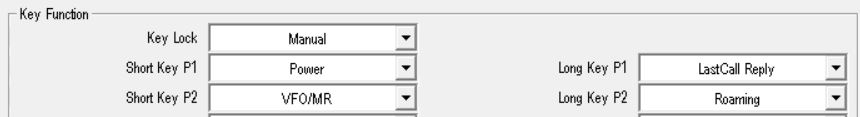

# How does one respond to a PRIVATE CALL

!!! info "Source"
    Originally published by Norman Williams on hamradiosouthernrepeaters.co.uk. [Original PDF](../originals/images/Anytone/How_does_one_respond_to_a_PRIVATE_CALL.pdf) · [Source](https://hamradiosouthernrepeaters.co.uk/images/Anytone/How_does_one_respond_to_a_PRIVATE_CALL.pdf) Hub item 66.

The easiest way is, to set “**last call reply**“ to a Function key.

*Key Function: Short Key P1 = Power, Short Key P2 = VFO/MR, Long Key P1 = LastCall Reply, Long Key P2 = Roaming; Key Lock = Manual.*

Whenever you hear someone you want to talk to - no matter if Private or in a Talk Group - press this key AFTER the other one‘s transmission has ended.
Then the radio sets them as Private Call into your radio and you can reply to them.

Now you can talk via Private Call.

Info by Markus Große-Schware

You might also wish to read this document
[Private Call](private-call-anytone.md)

## Information

Private call can be done on either time slots and the other party will receive you.
If using a Repeater use the seconder slot, as while your in private call that slot can not be used by others (UK use Slot 1 as Slot 2 is Primary).

**Private call via a repeater does not mean that others can not listen in.**
**Newer radios can listen in, so be aware of what you say over the air.**

**This can also happen over a Hotspot if someone is close enough to your Hotspot and has your frequency and Colour Code.**
**Your Hotspot information is public via Brandmeister Dashboards.**

**All Amateur Radios rules apply when using Private Call.**
