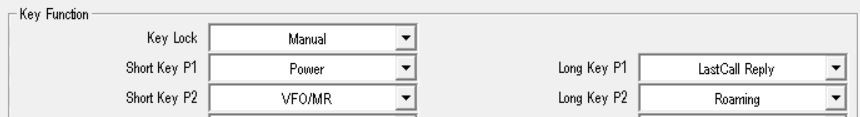

# Last Call Reply

!!! info "Source"
    Originally published by Norman Williams on hamradiosouthernrepeaters.co.uk. [Original PDF](../originals/images/Anytone/Last_Call_Reply.pdf) · [Source](https://hamradiosouthernrepeaters.co.uk/images/Anytone/Last_Call_Reply.pdf) Hub item 70.

Set “**LastCall reply**“ to any Function key.

*Key Function: Long Key P1 = LastCall Reply.*

“Last call reply“ does what the name says: it sets the AnyTone to answer the last call.

- On a call to a Talk Group, it sets it to the incoming Talk Group.
- On an incoming Private Call, it sets the AnyTone to call the caller as Private Call.

Info by Markus Große-Schware

## Information

Private call can be done on either time slot and the other party will receive you.

If using a Repeater, use the secondary slot, as while you're in private call that slot can not be used by others (UK use Slot 1, as Slot 2 is Primary).

!!! warning
    Private call via a repeater does not mean that others can not listen in. Newer radios can listen in, so be aware of what you say over the air.

    This can also happen over a Hotspot if someone is close enough to your Hotspot and has your frequency and Colour Code. Your Hotspot information is public via Brandmeister Dashboards.

**All Amateur Radio rules apply when using Private Call.**
