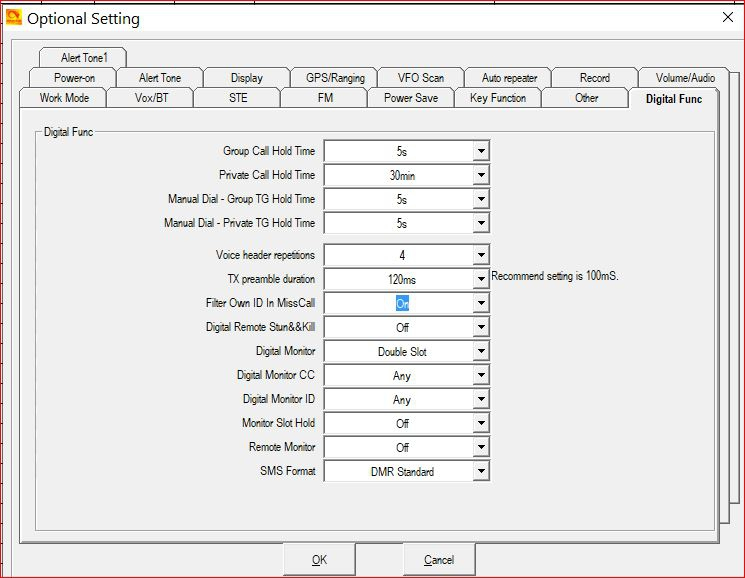

# Missed Call Window v2

!!! info "Source"
    Originally published by Norman Williams on hamradiosouthernrepeaters.co.uk. [Original PDF](../originals/images/Anytone/Missed_Call_Window.pdf) · [Source](https://hamradiosouthernrepeaters.co.uk/images/Anytone/Missed_Call_Window.pdf) Hub item 82.

1. This window pops up when you do a private call to commands like 4000, 9990, 5000 etc.

    **To remove it**, go to **CPS → Optional Settings → Digital Func** and turn Filter Own ID in MissCall ON.

    

    *Digital Func: Group Call Hold Time = 5s, Private Call Hold Time = 30min, Manual Dial - Group TG Hold Time = 5s, Manual Dial - Private TG Hold Time = 5s, Voice header repetitions = 4, TX preamble duration = 120ms (label beside it: Recommend setting is 100mS.), Filter Own ID In MissCall = On, Digital Remote Stun&&Kill = Off, Digital Monitor = Double Slot, Digital Monitor CC = Any, Digital Monitor ID = Any, Monitor Slot Hold = Off, Remote Monitor = Off, SMS Format = DMR Standard.*

2. If someone sends you a Private Call, you will get this window to show you had a Private Call.

[This link](../getting-started/settings-i-use.md) will show my other settings I use.
