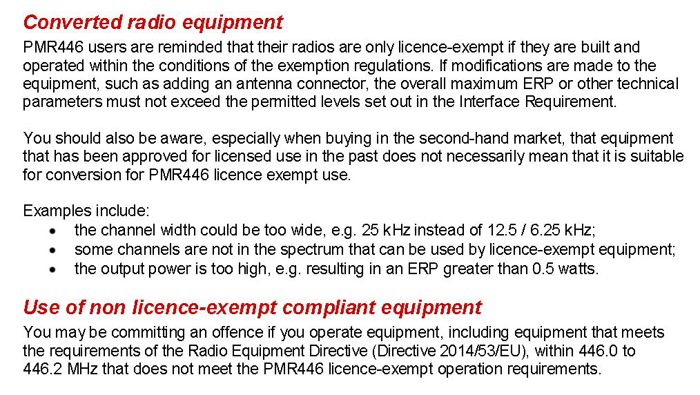

# PMR 446

!!! info "Source"
    Originally published by Norman Williams on hamradiosouthernrepeaters.co.uk. [Original PDF](../originals/images/Anytone/PMR_446.pdf) · [Source](https://hamradiosouthernrepeaters.co.uk/images/Anytone/PMR_446.pdf) Hub item 60.

Anytone 168 - 868 – 878 – 578

**Can not** be used on PMR 446 or dPMR 446

<https://www.ofcom.org.uk/__data/assets/pdf_file/0025/85156/ir_2009_analogue_and_digita1.pdf>

### Converted radio equipment

PMR446 users are reminded that their radios are only licence-exempt if they are built and operated within the conditions of the exemption regulations. If modifications are made to the equipment, such as adding an antenna connector, the overall maximum ERP or other technical parameters must not exceed the permitted levels set out in the Interface Requirement.

You should also be aware, especially when buying in the second-hand market, that equipment that has been approved for licensed use in the past does not necessarily mean that it is suitable for conversion for PMR446 licence exempt use.

Examples include:

- the channel width could be too wide, e.g. 25 kHz instead of 12.5 / 6.25 kHz;
- some channels are not in the spectrum that can be used by licence-exempt equipment;
- the output power is too high, e.g. resulting in an ERP greater than 0.5 watts.

### Use of non licence-exempt compliant equipment

You may be committing an offence if you operate equipment, including equipment that meets the requirements of the Radio Equipment Directive (Directive 2014/53/EU), within 446.0 to 446.2 MHz that does not meet the PMR446 licence-exempt operation requirements.
