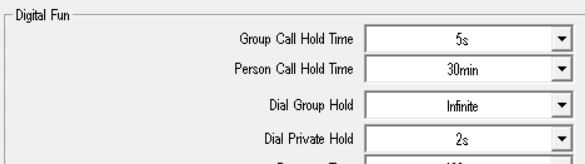

# Private Call

!!! info "Source"
    Originally published by Norman Williams on hamradiosouthernrepeaters.co.uk. [Original PDF](../originals/images/Anytone/Private_Call_Anytone.pdf) · [Source](https://hamradiosouthernrepeaters.co.uk/images/Anytone/Private_Call_Anytone.pdf) Hub item 34.

Anytone 868 – 878 – 578

Do a Manual Dial -
Go to **Menu → Talk Group → Manual Dial** - enter the users 7 dig ID number *1234567*.
Do not push any other buttons – Just the PTT and talk.

\* Depending on the hang time set in your CPS you will stay connected as long as you both replay to each other within that time.

*Digital Fun: Group Call Hold Time = 5s, Person Call Hold Time = 30min, Dial Group Hold = Infinite, Dial Private Hold = 2s.*

*Photo is for demonstration only.*

I would recommend taking the Hold time in the CPS for **Person Call Hold Time** and **Dial Private Hold** to its maximum.

If you do exceeded your hold time you will have to follow the steps above again.

or

You can add the users 7 dig ID to your Talk group list as PRIAVTE CALL.
Then make up a channel, add to a Zone as you would for normal channels.
Turn the radio to that channel and talk to each other.

or

You can also do Private Call by Holding down the 0 key.
Enter the users 7 dig ID number *1234567*.
Do not push any other buttons – Just the PTT and talk.
\* **Dial Private Hold** will also need to be set to HIGHT if using this method.
If you do exceeded your hold time you will have to follow the steps above again.

## How to clear a private call.

As you have set the hang times high, the fastest way to clear the private call is just turn the channel knob up or down one channel and back.

You might also wish to read this document
How does one respond to a PRIVATE CALL

## Information

Private call can be done on either time slots and the other party will receive you.
If using a Repeater use the seconder slot, as while your in private call that slot can not be used by others (UK use Slot 1 as Slot 2 is Primary).

**Private call via a repeater does not mean that others can not listen in.
Newer radios can listen in, so be aware of what you say over the air.**

**This can also happen over a Hotspot if someone is close enough to your Hotspot and has your frequency and Colour Code.
Your Hotspot information is public via Brandmeister Dashboards.**

All Amateur Radios rules apply when using Private Call.

## Links in the original PDF

- [You might also wish to read this document How does one respond to a PRIVATE CALL](how-does-one-respond-to-a-private-call.md)
