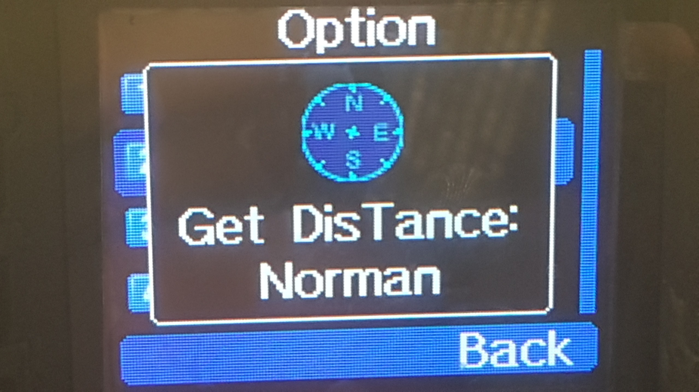
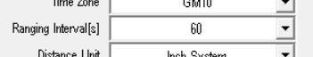
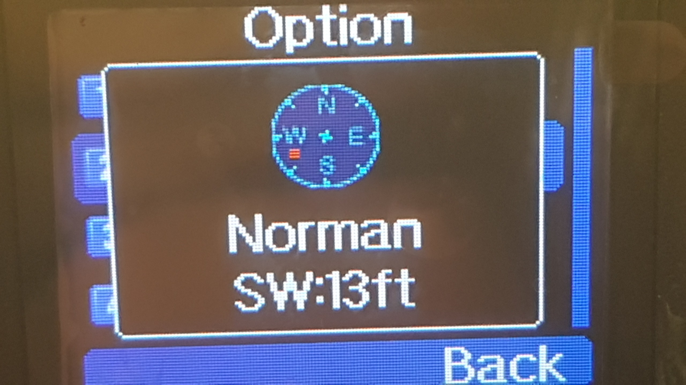
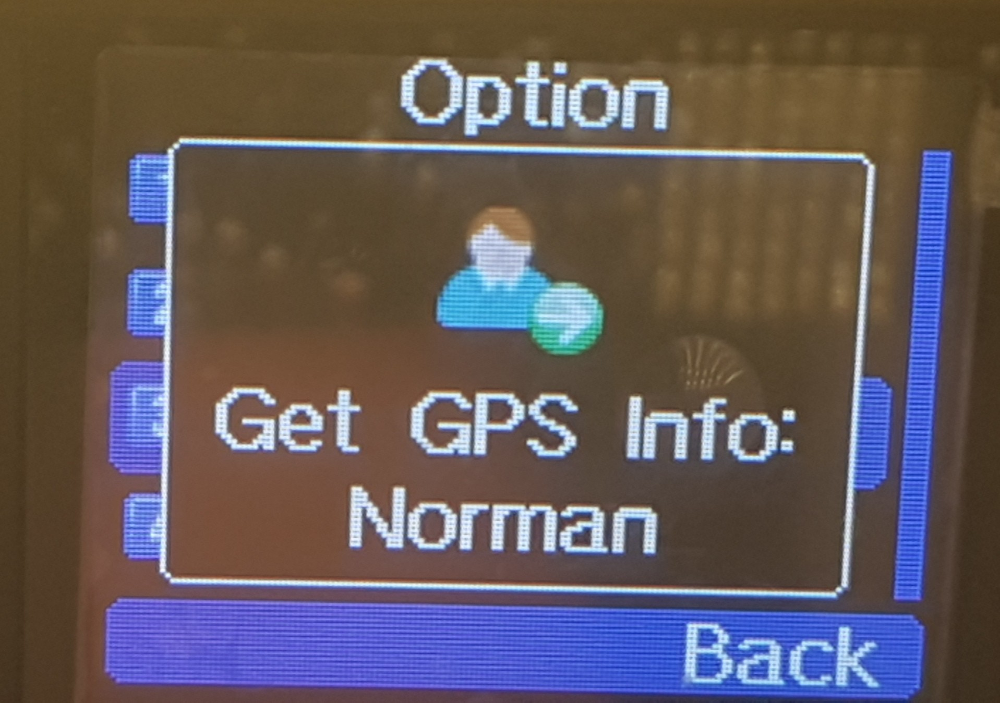
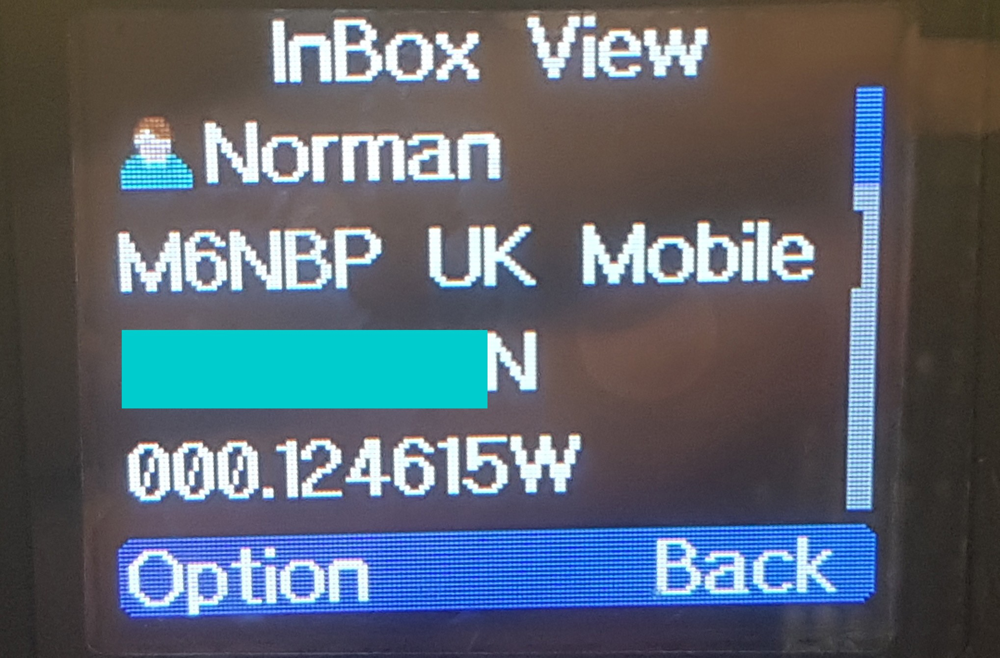

# Ranging v3

!!! info "Source"
    Originally published by Norman Williams on hamradiosouthernrepeaters.co.uk. [Original PDF](../originals/images/Anytone/Ranging.pdf) · [Source](https://hamradiosouthernrepeaters.co.uk/images/Anytone/Ranging.pdf) Hub item 47.

This lets you find two forms off information from another Anytone compatible radio.

1. Distance.
2. GPS Longitude and Latitude.

## Via a DMR Simplex Frequency or Channel

1. Both parties need to be on the same Frequency.
2. Both parties need to use the same Slot, Colour Code and Talk Group.
3. Both parties need different radio IDs.
4. Both parties need to have GPS turned on.
5. You need to have the other party added to your “Talk Groups” List as a private call.

## Now for the fun part and how to use.

**Via the radio -**
A. Click on *LIST*
B. Go to the Contact you wish to use
C. Click on *Select*
D. Click on *View Contact*
E. Click on *Option*

**Now we see the two options we will be using -**
*Measure Period*
*Get GPS Info*

**We will use *Measure Period* first.**
Click on *Measure Period* and you will see this display.

The radio will keep sending a request at time intervals set under GPS/Ranging and if the other radio is within range your will get a reply.

*GPS/Ranging: Ranging Interval[s] = 60, Distance Unit = Inch System (partly cut off).*

*The other party will see the request on his/her radio.*

It will display the direction and distance.
It will keep requesting this info until you click on the back key.

**Now for *Get GPS Info***
Click on *Get GPS Info* and you will see this display as request is sent.

If the other radio is within range your will get a Text Message back.
*The other party will see the request on his/her radio.*

## Via a DMR Network (Tested on Brandmeister)

1. Might Not work on all DMR Networks.
2. Brandmeister under [Selfcare](https://brandmeister.network/?page=login) you must set for Motorola radio.
3. Both parties need to be on the same Network.
4. Both parties do not need to be on the same Talk Group. \*\*
5. Both parties need different radio IDs.
6. Both parties need to have GPS turned on.
7. You need to have the other party added to your “Talk Groups” List as a private call.

Use the same steps as outlined above from **Now for the fun part and how to use.**

[Video](https://www.youtube.com/watch?v=RlarpP1rlxg)

## Some info and tips.

\*\* Over the network it can be very hit and miss if you get a reply back from the other party.
What we have found during testing on Brandmeister is -

1. The party your requesting info from, should PTT in to any Talk Group when they see the request show up on the radio.
2. This lets the network map the request and send the request back to who requested it.
3. Doing the above has worked on both options *Measure Period* and *Get GPS Info.*
4. Some Networks you might need to be on the same Talk Group.

In each channel you have a box called Ranging.
I would recommend not ticking this box if you use Private Call to talk to your friends.
IF GPS is turned on and you Private Call a friend, it will start *Measure Period* that person and tie up the radios for both parties. (Turn GPS Off if this happens)

Setting a Key for Ranging.
All this does is send the request for *Measure Period* one time only.
Better to not use and follow the options above.
