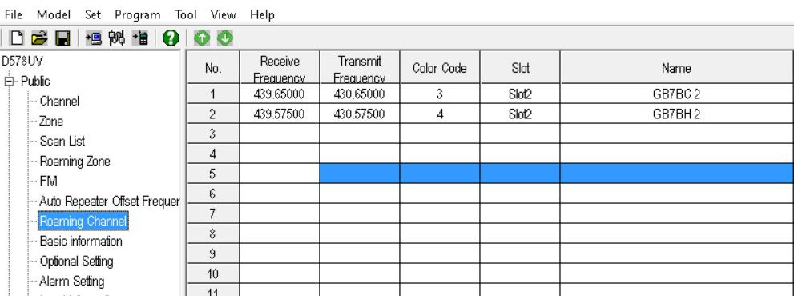
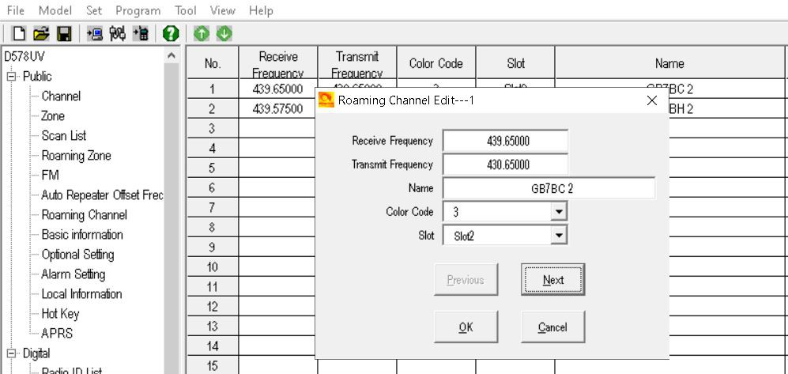
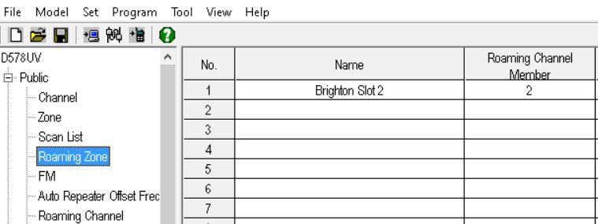
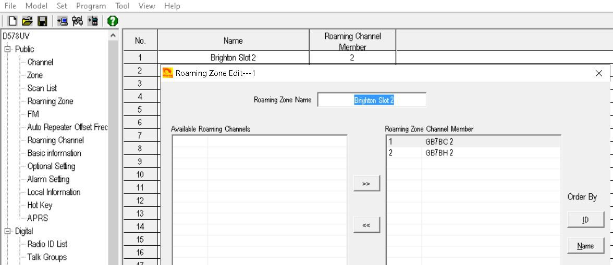
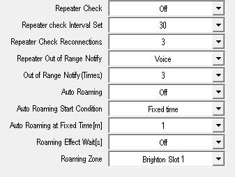
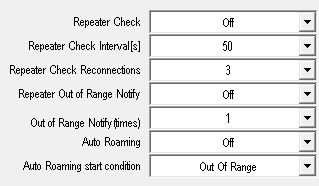
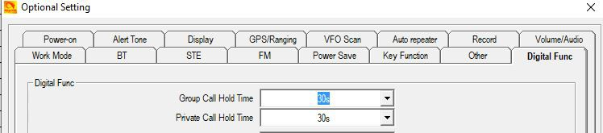

# Roaming

!!! info "Source"
    Originally published by Norman Williams on hamradiosouthernrepeaters.co.uk. [Original PDF](../originals/images/Anytone/Roaming.pdf) · [Source](https://hamradiosouthernrepeaters.co.uk/images/Anytone/Roaming.pdf) Hub item 49.

"What is roaming? Is it useful? And when should I use it?"

It is a commercial DMR feature adapted to the amateur world.
Basically what it's going to do is allow you ... Say you're driving in a city from the south side to the north side, and there's five repeaters along the way.
If you have roaming on, the radio will change channels to the repeater that is the strongest and closest to you automatically as you move geographically towards the strongest repeaters.

Say you're sitting in your house with your radio and your hotspot, roaming is going to do nothing for you, because your radio doesn't need to change frequencies.
It doesn't need to change channels, but you're going to stay on the same thing because you're not moving anywhere, and the signal's constant.

So for some people, that travel around in the city and you want your radio to change automatically, it's going to be great for you.
But for other people, like say with hotspots or people that primarily operate stationary, this isn't going to do much.

## Down side off roaming.

Not all DMR Networks offer/permit roaming.
When you move to the next repeater, that Time Slot has to be free for you to use it.
If it is not free, you just get the – Chan Busy!

## How to set up Roaming

**CPS → Left Hand side → Roaming Channel**

*Roaming Channel 1: 439.65000 / 430.65000, Color Code 3, Slot2, GB7BC 2. Roaming Channel 2: 439.57500 / 430.57500, Color Code 4, Slot2, GB7BH 2.*

Double click on the first line anywhere.
A new window will open.

*Roaming Channel Edit---1: Receive Frequency = 439.65000, Transmit Frequency = 430.65000, Name = GB7BC 2, Color Code = 3, Slot = Slot2.*

**Now you have to fill in all sections -**
Receive Frequency (For that repeater)
Transmit Frequency (For that repeater)
Name (For that repeater)
Color Code (For that repeater)
Slot (For that repeater and the slot you wish to use)

**Repeat the above for all Repeaters, that you wish to roam in your area.**

## Now we have to add the Channels to Roaming Zone

*Roaming Zone 1: Name = Brighton Slot 2, Roaming Channel Member = 2.*

Double click on the first line anywhere.
A new window will open.

*Roaming Zone Edit---1: Roaming Zone Name = Brighton Slot 2; Roaming Zone Channel Member = GB7BC 2, GB7BH 2.*

Roaming Zone Name - Give the Zone a Name = Brighton

On the left column you will see all the Roaming channels you have made up.
Move them to the right column, the ones you wish to use in that Zone.
*I only have to two repeaters in my area, as shown in the photo above.*

**Click OK to save the Zone.**
Repeat the above for all Zones that you wish to set up.
Save Code Plug and send to radio.

## Roaming Settings

578
*578: Repeater Check = Off, Repeater check Interval Set = 30, Repeater Check Reconnections = 3, Repeater Out of Range Notify = Voice, Out of Range Notify(Times) = 3, Auto Roaming = Off, Auto Roaming Start Condition = Fixed time, Auto Roaming at Fixed Time[m] = 1, Roaming Effect Wait[s] = Off, Roaming Zone = Brighton Slot 1.*

878
*878: Repeater Check = Off, Repeater Check Interval[s] = 50, Repeater Check Reconnections = 3, Repeater Out of Range Notify = Off, Out of Range Notify(times) = 1, Auto Roaming = Off, Auto Roaming start condition = Out Of Range.*

**CPS → Optional Settings → Auto Repeater**

You might have to play around with the setting.
Set the Roaming Setting for what best meets your needs.
\**Repeater check interval = This is the time scale the radio pings repeaters*
*Auto Roaming Start Connection = \*Fixed Time or Out Of Range*

## How to use on the radio

Lets say your on the first repeater. On Talk Group 3100 and you wish to roam.

Go to **Menu → Roaming**

**One time Roam** – It will roam one time only and move you to the next repeater if in range.
To move to another repeater you would have to do this step over again.

**Auto Roaming** – On/OFF = On
**Start Roaming** – This will start roaming and roaming will move you to the next repeater if in range and you will still be on Talk Group 3100

[Anytone Roaming Videos](https://www.google.com/search?client=firefox-b-d&sxsrf=ACYBGNT4h3ypkl1JRfZYEtbwRYM0TM7Qag:1576187458873&ei=QrbyXaz_NIqhgQbogbbwDg&q=Anytone+878+roaming&oq=Anytone+878+roaming&gs_l=psy-ab.3..35i39j0.35880.36293..36970...0.2..0.71.189.3......0....1..gws-wiz.......0i71j0i7i30.F8p8GMpfQuk&ved=0ahUKEwisqNfsi7HmAhWKUMAKHeiADe4Q4dUDCAo&uact=5)

## Group Call Hold Time

This should be set to 30s or lower

*Digital Func: Group Call Hold Time = 30s, Private Call Hold Time = 30s.*
