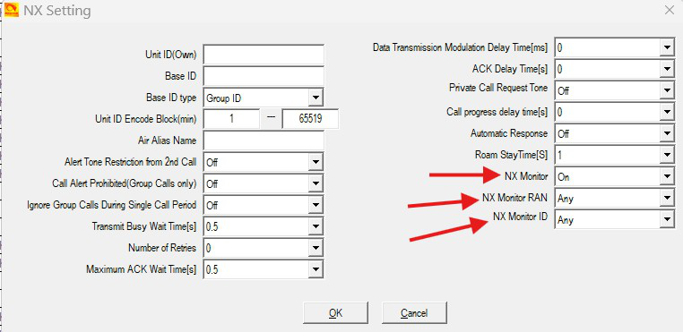

# Anytone AT-D890UV NXDN Digi Moni

!!! info "Source"
    Originally published by Norman Williams on hamradiosouthernrepeaters.co.uk. [Original PDF](../originals/images/Anytone/AT-D890UV_NXDN_Digi_Moni.pdf) · [Source](https://hamradiosouthernrepeaters.co.uk/images/Anytone/AT-D890UV_NXDN_Digi_Moni.pdf) Hub item 180.

In the CPS NX Setting, set to:

| Setting | Value |
|---|---|
| NX Monitor | ON |
| NX Monitor RAN | Any |
| NX Monitor ID | Any |

*NX Setting: NX Monitor = On, NX Monitor RAN = Any, NX Monitor ID = Any.*

## Turn Digi Moni on and off from radio

When in NXDN mode, go to **Menu → up to → Digi Moni** and turn it on or off.
