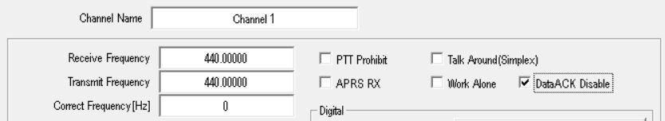

# DataACK Disable

!!! info "Source"
    Originally published by Norman Williams on hamradiosouthernrepeaters.co.uk. [Original PDF](../originals/images/Anytone/DataACK_Disable.pdf) · [Source](https://hamradiosouthernrepeaters.co.uk/images/Anytone/DataACK_Disable.pdf) Hub item 108.

**NOT REQUIRED for Ham Radio Repeaters**

Should not be ticked.

From Anytone

When the radio is monitoring the Mototurbo commercial repeaters, the radio will make a transmit to the repeater even if they select "TX prohibit", then the radio will freeze after doing a transmission to the repeater.

So we added the "DataACK Disable" option, the radio will not respond to the repeater.

Turn ON and OFF in each channel

*Channel 1: DataACK Disable ticked.*
