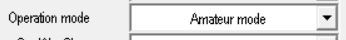

# Digi Moni is missing in radio

!!! info "Source"
    Originally published by Norman Williams on hamradiosouthernrepeaters.co.uk. [Original PDF](../originals/images/Anytone/Digi_Moni_is_missing_in_radio.pdf) · [Source](https://hamradiosouthernrepeaters.co.uk/images/Anytone/Digi_Moni_is_missing_in_radio.pdf) Hub item 104.

**Open the CPS and go to – Optional Settings → Other or Work Mode**

Change to **Amateur Mode**

*Choose working mode = amateur mode.*

or

*Operation mode = Amateur mode.*
