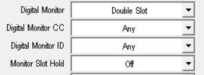

# Digi Moni

!!! info "Source"
    Originally published by Norman Williams on hamradiosouthernrepeaters.co.uk. [Original PDF](../originals/images/Anytone/Digi_Moni.pdf) · [Source](https://hamradiosouthernrepeaters.co.uk/images/Anytone/Digi_Moni.pdf) Hub item 46.

**What is Digital Monitor (Digi Moni) ?**
*Also know as Promiscuous on other radio*

**For Ham radio use via a Repeater**

1. It replaces the need for a RX group list
2. Lets you RX all Talk Groups used on Slot 1 or Slot 2 or Both Slots 1 and 2
    *This means no matter what Talk Group is being used you can RX it.*

**Setting I would recommend -**
**CPS → Optional Settings → Digital Fun**

*Digital Monitor = Single Slot, Digital Monitor CC = Any, Digital Monitor ID = Any, Monitor Slot Hold = Off.*

**Digital Monitor options -**
Off
Single Slot     ( Will RX all Talk Groups being used on that Slot 1 or 2 )
Double Slot   ( Will RX all Talk Groups being used on Both Slots 1 and 2 )

Digital Monitor CC  = Any     ( Best for scanning )
Digital Monitor ID   = Any     ( Best for scanning )
Monitor Slot Hold    = Off      ( I use OFF so it can swap slots )

**For Scanning I would make one change -**
Digital Monitor = Double Slot   (Will RX all Talk Groups being used on Both Slots 1 and 2 )

*Digital Monitor = Double Slot, Digital Monitor CC = Any, Digital Monitor ID = Any, Monitor Slot Hold = Off.*

**Via Hotspots**
Simplex  Hotspot – Only Required if you have set Static Talk Groups.
Duplex Hotspot – If you have Static Talk Groups. If you want to listen on both slots.
