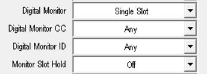

# Digi Moni

!!! info "Source"
    Originally published by Norman Williams on hamradiosouthernrepeaters.co.uk. [Original PDF](../originals/images/Anytone/Digi_Moni.pdf) · [Source](https://hamradiosouthernrepeaters.co.uk/images/Anytone/Digi_Moni.pdf) Hub item 46.

## What is Digital Monitor (Digi Moni)?

*Also known as Promiscuous on other radios.*

### For ham radio use via a repeater

1. It replaces the need for a RX group list.
2. Lets you RX all Talk Groups used on Slot 1 or Slot 2 or both Slots 1 and 2. This means no matter what Talk Group is being used you can RX it.

### Settings I would recommend

**CPS → Optional Settings → Digital Func**

*Digital Monitor = Single Slot, Digital Monitor CC = Any, Digital Monitor ID = Any, Monitor Slot Hold = Off.*

Digital Monitor options:

| Option | Effect |
|---|---|
| Off | |
| Single Slot | Will RX all Talk Groups being used on that Slot 1 or 2 |
| Double Slot | Will RX all Talk Groups being used on both Slots 1 and 2 |

| Setting | Value |
|---|---|
| Digital Monitor CC | Any (best for scanning) |
| Digital Monitor ID | Any (best for scanning) |
| Monitor Slot Hold | Off (I use OFF so it can swap slots) |

### For scanning

For scanning I would make one change: Digital Monitor = Double Slot (will RX all Talk Groups being used on both Slots 1 and 2).

*Digital Monitor = Double Slot, Digital Monitor CC = Any, Digital Monitor ID = Any, Monitor Slot Hold = Off.*

### Via hotspots

- **Simplex hotspot** – only required if you have set Static Talk Groups.
- **Duplex hotspot** – if you have Static Talk Groups; if you want to listen on both slots.
