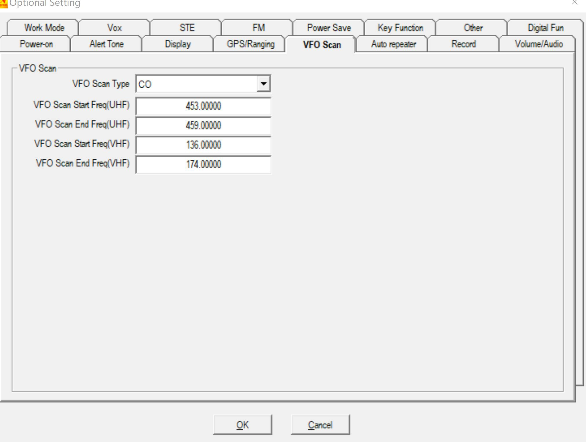
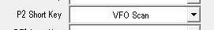
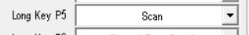

# How to scan between two sets of frequencies.

!!! info "Source"
    Originally published by Norman Williams on hamradiosouthernrepeaters.co.uk. [Original PDF](../originals/images/Anytone/How_to_scan_between_two_sets_of_frequencies.pdf) · [Source](https://hamradiosouthernrepeaters.co.uk/images/Anytone/How_to_scan_between_two_sets_of_frequencies.pdf) Hub item 65.

**In the CPS → Optional Settings → VFO Scan**
Set your start and end Frequencies

*VFO Scan: VFO Scan Type = CO, VFO Scan Start Freq(UHF) = 453.00000, VFO Scan End Freq(UHF) = 459.00000, VFO Scan Start Freq(VHF) = 136.00000, VFO Scan End Freq(VHF) = 174.00000.*

Go to VFO Mode on the radio.

**Push Programming Scan Key to start scan.**
*(You will need to set a Function Key for VFO Scan)*

*P2 Short Key = VFO Scan.*

Scan Type: Select

- CO resumes when carrier drops;
- TO resumes after several seconds (regardless of carrier);
- SE ends scan once a signal is found.

You might want to read “[Scanning DMR VFO Frequencies](scanning-dmr-vfo-frequencies.md)”

## To Scan Frequencies outside this range.

Enter a Frequency via the Key Pad

**Push Scan Key to start scan.**
*(You will need to set a Function Key for Scan)*

*Long Key P5 = Scan.*

## TIPS

- Turning the Channel knob left will make the scan go down the Frequencies
- Turning the Channel knob right will make the scan go up the Frequencies
