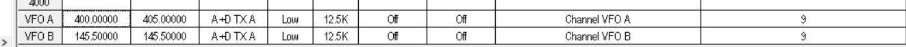

# Scanning DMR VFO Frequencies

!!! info "Source"
    Originally published by Norman Williams on hamradiosouthernrepeaters.co.uk. [Original PDF](../originals/images/Anytone/Scanning_DMR_VFO_Frequencies.pdf) · [Source](https://hamradiosouthernrepeaters.co.uk/images/Anytone/Scanning_DMR_VFO_Frequencies.pdf) Hub item 43.

## Tier I = Simplex

1. Set up your VFO channel as normal with the TX and RX frequencies the same.
2. Set VFO channel to DMR Mode – Simplex.

## Tier II = Repeaters

1. To get Tier II we have to set up the VFO frequencies with a split: RX 4xx.xxxx – TX 45x.xxx. This now tells the radio it is decoding Tier II.
2. Set VFO channel to DMR Mode – Repeater.

*5 Meg split is handy to work with. It could be 1, 2, 3 etc Meg apart as you're not going to TX, as long as the RX and TX frequencies are different.*

!!! tip
    You will find the VFO channels at the very bottom of the channels in the CPS. Scroll down.

*VFO A: RX 400.00000, TX 405.00000, Low power, 12.5K, Channel VFO A. VFO B: RX 145.50000, TX 145.50000, Low power, 12.5K, Channel VFO B.*

You will see my:

| VFO | Use |
| --- | --- |
| VFO A | Tier II for Repeaters |
| VFO B | Tier I for Simplex |

Ignore that one is UHF and the other is VHF. You just go to the VFO you require and type in a frequency, VHF or UHF, and hit scan.

Set the correct DMR Mode for each channel as well as the 2 VFO channels.

*DMR MODE options: DMO/simplex, Repeater, DCDM/Double Slot, DCDM TS split.*

## Scan Type: Select

| Scan Type | Behaviour |
| --- | --- |
| CO | Resumes when carrier drops |
| TO | Resumes after several seconds (regardless of carrier) |
| SE | Ends scan once a signal is found |

## Digi Moni

I would also turn on Digi Moni:

| Setting | Value |
| --- | --- |
| DigiMoni Switch | Double Slot |
| DigiMoni Cc | Any Cc |
| DigMoni Id | Any Id |
| Slot Hold | You can have Off or On, depending on your needs |

## Frequency Step

**CPS → Optional Setting → Other** – set to 12.5K.

## You should also set the hold times low

To match the **Scan Type: Select** above.

*Digital Func: Group Call Hold Time = 5s; Private Call Hold Time = 5s; Manual Dial hold times = 5s; Digital Monitor = Double Slot; Digital Monitor CC = Any; Digital Monitor ID = Any; Monitor Slot Hold = Off; Remote Monitor = Off.*

## If you want to make it as a channel

### Tier I = Simplex

1. Set up your channel as normal with the TX and RX frequencies the same.
2. Set channel to DMR Mode – Simplex.

### Tier II = Repeaters

1. To get Tier II we have to set up the channels with a split: RX 4xx.xxxx – TX 45x.xxx. This now tells the radio it is decoding Tier II.
2. Set channel to DMR Mode – Repeater.

*5 Meg split is handy to work with. It could be 1, 2, 3 etc Meg apart as you're not going to TX, as long as the RX and TX frequencies are different and set to Repeater.*

## Function Keys

| Key | What it does |
| --- | --- |
| VFO Scan | Scans within the band, VHF or UHF only (set in VFO Scan) |
| Scan | Scans both bands, VHF and UHF, one after the other (set in VFO Scan) |

*VFO Scan Type = TO; UHF 400.00000 to 480.00000; VHF 136.00000 to 174.00000.*

!!! note "Added to newer firmware"
    Press the **Menu** key on the radio to stay at the VFO/channel with signal permanently when it finds a signal during scanning.

Also have a look at the documents for [Scanning](scanning.md) and [DataACK Disable](dataack-disable.md).
