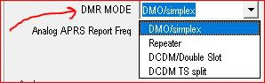
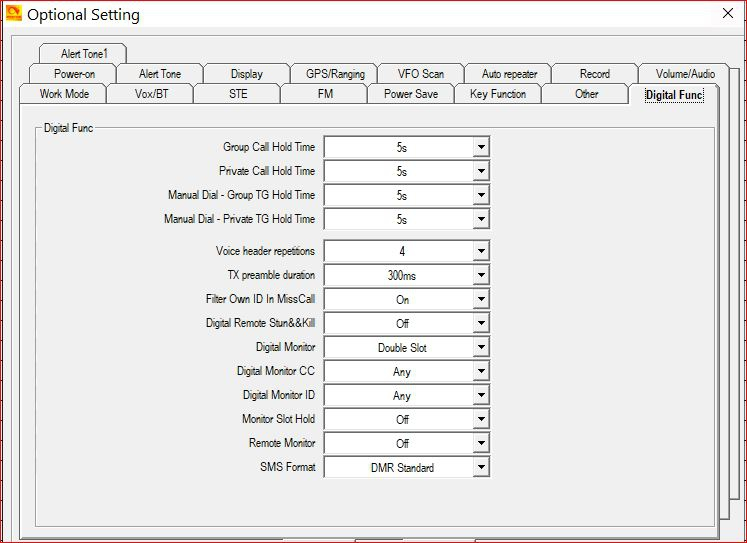
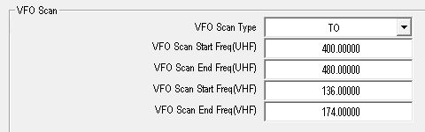

# Scanning DMR VFO Frequencies

!!! info "Source"
    Originally published by Norman Williams on hamradiosouthernrepeaters.co.uk. [Original PDF](../originals/images/Anytone/Scanning_DMR_VFO_Frequencies.pdf) · [Source](https://hamradiosouthernrepeaters.co.uk/images/Anytone/Scanning_DMR_VFO_Frequencies.pdf) Hub item 43.

## Tier I = Simplex

Set up your VFO channel as normal with the TX and RX Frequencies the same.
Set VFO channel to DMR Mode - Simplex

## Tier II = Repeaters

To get Tier II we have to setup the VFO Frequencies with a split.
RX 4xx.xxxx – TX 45x.xxx
This now tells the radio it is decoding Tier II
Set VFO Channel to DMR Mode - Repeater

*5 Meg Split is handy to work with. It could be 1, 2, 3 etc Meg apart as your not going to TX.*
As long as the RX and TX Frequencies is different

*You will find the VFO channels at the very bottom off the channels in the CPS. Scroll down.*

*VFO A: RX 400.00000, TX 405.00000, Low power, 12.5K, Channel VFO A. VFO B: RX 145.50000, TX 145.50000, Low power, 12.5K, Channel VFO B.*

**You will see my**
VFO A = Tier II for Repeaters
VFO B = Tier I  for Simplex

Ignore that one is UHF and the other is VHF.
You just go to the VFO you require and type in a Frequency VHF or UHF and hit scan.

Set the Correct DMR Mode for each channel as well as the 2 VFO Channels.

*DMR MODE options: DMO/simplex, Repeater, DCDM/Double Slot, DCDM TS split.*

**Scan Type: Select**
CO resumes when carrier drops;
TO resumes after several seconds (regardless of carrier);
SE ends scan once a signal is found.

**I would also turn on Digi Moni**
DigiMoni Switch = Double Slot
DigiMoni Cc = Any Cc
DigMoni Id = Any Id
Slot Hold = You can have OFF or On, depending on your needs.

**Frequency Step**
**CPS → Optional Setting → Other**
Set to 12.5K

## You should also set the Hold times low.

To match the **Scan Type: Select** above.

*Digital Func: Group Call Hold Time = 5s; Private Call Hold Time = 5s; Manual Dial hold times = 5s; Digital Monitor = Double Slot; Digital Monitor CC = Any; Digital Monitor ID = Any; Monitor Slot Hold = Off; Remote Monitor = Off.*

## IF you want to make as a channel

### Tier I = Simplex

Set up your channel as normal with the TX and RX Frequencies the same.
Set Channel to DMR Mode - Simplex

### Tier II = Repeaters

To get Tier II we have to setup the channels with a split.
RX 4xx.xxxx – TX 45x.xxx
This now tells the radio it is decoding Tier II
Set channel to DMR Mode - Repeater

*5 Meg Split is handy to work with. It could be 1, 2, 3 etc Meg apart as your not going to TX.*
As long as the RX and TX Frequencies is different and set to Repeater

## Function Keys

**VFO Scan** = Scans within the band VHF or UHF only (Set in VFO Scan)
**Scan** = Scans both bands VHF and UHF one after the other (Set in VFO Scan)

*VFO Scan Type = TO; UHF 400.00000 to 480.00000; VHF 136.00000 to 174.00000.*

**Added to newer Firmware**
Press Menu key on radio to stay at the vfo/channel with signal permanently when it finds a signal during scanning.

Also have a look at the documents for [Scanning](scanning.md) and [DataACK Disable](dataack-disable.md)
