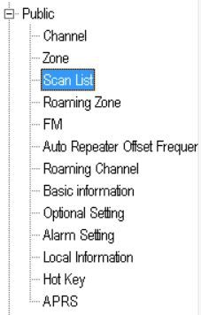
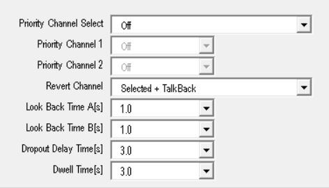
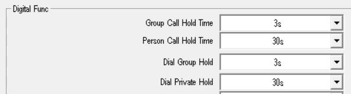
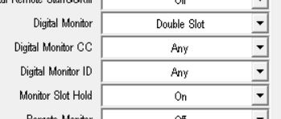
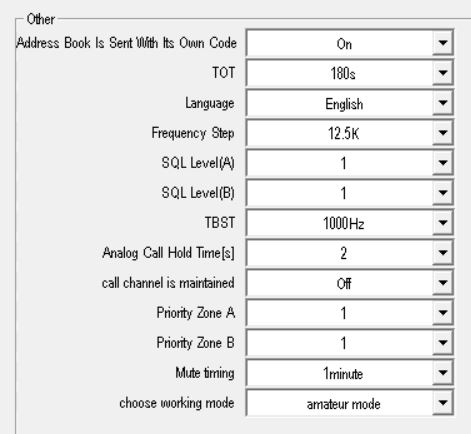
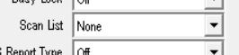

# Scanning

!!! info "Source"
    Originally published by Norman Williams on hamradiosouthernrepeaters.co.uk. [Original PDF](../originals/images/Anytone/Scanning.pdf) · [Source](https://hamradiosouthernrepeaters.co.uk/images/Anytone/Scanning.pdf) Hub item 23.

Scan List is on the left hand side of the CPS.

You will need to play around with the next settings for what meets your needs.

| Setting | Value |
| --- | --- |
| Revert Channel | Selected + TalkBack (lets you talk back on that channel it stopped on) |

Also read this info by Jason: [How to reply on an active channel found while scanning](../mods/868-878/18-talkback-hint.md)

*Priority Channel Select = Off, Revert Channel = Selected + TalkBack, Look Back Time A[s] = 1.0, Look Back Time B[s] = 1.0, Dropout Delay Time[s] = 3.0, Dwell Time[s] = 3.0.*

## Group Call Hold Time

**CPS → Optional Setting → Digital Fun → Group Call Hold Time**

For digital channels, set the Group Call Hold Time the same as the Dwell Time[s].

*Digital Func: Group Call Hold Time = 3s, Person Call Hold Time = 30s, Dial Group Hold = 3s, Dial Private Hold = 30s.*

!!! tip
    For best results use 3s or 5s.

### Examples

You could have Dwell time at 3 or 5 sec, so I would set Group Hang to 3 or 5 sec to match.

| Dwell | Group Hang | Result |
| --- | --- | --- |
| 3 sec | 30s | The scan will not start again on DMR channels for 30 sec |
| 3 sec | 30 min | The scan will not start again on DMR channels for 30 min |
| 3 sec | Infinity | The scan will not start again on DMR channels |

## Digital Monitor

**CPS → Optional Setting → Digital Fun → Digital Monitor**

| Setting | Value |
| --- | --- |
| Digital Monitor | Can be Double or Single depending on your requirements |
| Monitor Slot Hold | Can be On or Off depending on your requirements |

*Digital Monitor = Double Slot, Digital Monitor CC = Any, Digital Monitor ID = Any, Monitor Slot Hold = On.*

## Other settings

**CPS → Optional Setting → Other**

The below settings can affect how the radio scans:

- Frequency Step
- SQL Level A & B
- Analog Call Hold Times[s]
- Priority Zones A & B

*Other: Frequency Step = 12.5K, SQL Level(A) = 1, SQL Level(B) = 1, Analog Call Hold Time[s] = 2, Priority Zone A = 1, Priority Zone B = 1, choose working mode = amateur mode.*

## Scan List in each channel

Set the Scan List you wish to use, e.g. *Home, Repeater, Hotspot etc.*

*Scan List = None.*

## To scan

1. Set up a Function Key = Scan.
2. Push your key function to start/stop SCAN.

!!! note "Update 16/06/2020"
    Press the **Menu** key on the radio to stay at the channel with signal permanently when it finds a signal during scanning. The radio is unable to switch to that channel if the channel doesn’t belong to a zone.

Also have a look at the documents for [Scanning DMR VFO Frequencies](scanning-dmr-vfo-frequencies.md) and [DataACK Disable](dataack-disable.md).

## Links in the original PDF

- [Also hav Disable](dataack-disable.md)
