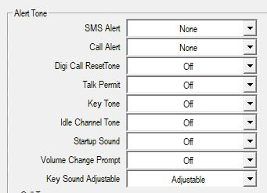
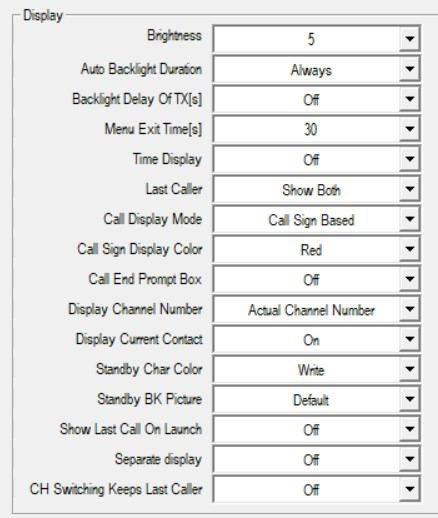
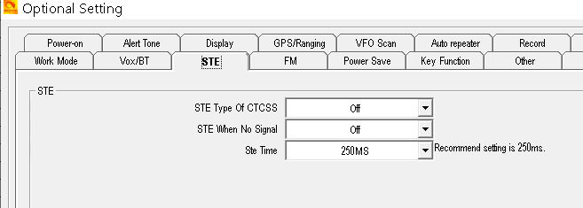

# 3 Beeps

!!! info "Source"
    Originally published by Norman Williams on hamradiosouthernrepeaters.co.uk. [Original PDF](../originals/images/Anytone/3_Beeps.pdf) · [Source](https://hamradiosouthernrepeaters.co.uk/images/Anytone/3_Beeps.pdf) Hub item 113.

Turn off and on as required.
**CPS → Optional Setting → Alert Tones**

*Alert Tone: SMS Alert = None, Call Alert = None, Digi Call ResetTone = Off, Talk Permit = Off, Key Tone = Off, Idle Channel Tone = Off, Startup Sound = Off, Volume Change Prompt = Off, Key Sound Adjustable = Adjustable.*

Call End Prompt Box – On / Off
**CPS → Optional Setting → Display**

*Display: Call End Prompt Box = Off (Brightness = 5, Auto Backlight Duration = Always, Menu Exit Time[s] = 30, Last Caller = Show Both, Call Display Mode = Call Sign Based).*

Turn off STE
**CPS → Optional Setting → STE**

*STE: STE Type Of CTCSS = Off, STE When No Signal = Off, Ste Time = 250MS (label beside it: Recommend setting is 250ms.).*

Also change your Tones

Make your radio sound like a Motorola and other fun tone sequences to play with
[https://hamradiosouthernrepeaters.co.uk/images/878Mods/878techmods.html#TPTchirp](../mods/868-878/33-tptchirp.md)
