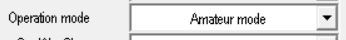

# Function Keys not Working

!!! info "Source"
    Originally published by Norman Williams on hamradiosouthernrepeaters.co.uk. [Original PDF](../originals/images/Anytone/Function_Keys_not_Working.pdf) · [Source](https://hamradiosouthernrepeaters.co.uk/images/Anytone/Function_Keys_not_Working.pdf) Hub item 136.

Open the CPS and go to **Optional Settings → Other** or **Work Mode**

Change to **Amateur Mode**

*choose working mode = amateur mode.*

or

*Operation mode = Amateur mode.*
