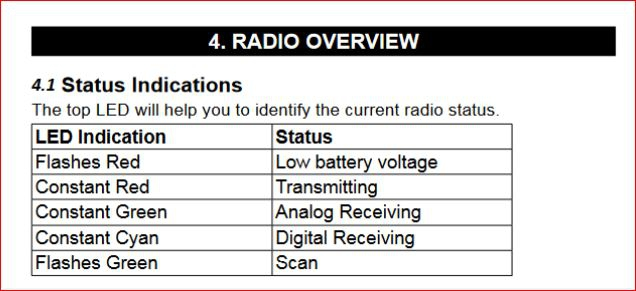

# Green Irregular Blinking Led

!!! info "Source"
    Originally published by Norman Williams on hamradiosouthernrepeaters.co.uk. [Original PDF](../originals/images/Anytone/Green_Irregular_Blinking_Led.pdf) · [Source](https://hamradiosouthernrepeaters.co.uk/images/Anytone/Green_Irregular_Blinking_Led.pdf) Hub item 63.

**Q.** From time to time my radio blinks green at irregular intervals.

**A.** All it means is a RF is being detected.

1. If working a DMR repeater it could be the other time slot is in use.
    - Could be SMS or APRS being sent by another user.
    - Could be a user in Private call. (Use Digi Moni to RX)
    - Could be sending out Beacons or CW ID.
2. If working Mixed Mode Repeater or Hotspot, D-Star or Fusion etc could be in use.
    - Could be sending out Beacons or CW ID.
3. Analog could be in use on that Frequency.
    - Could be sending out Beacons or CW ID.
4. As all Hotspots in the UK should all be on the same two UHF Frequencies, it can be RF from other users. (No 2 applies)
    - 434.000 and 438.800 [Low Power Non-NoV Personal Hot-Spot](https://rsgb.services/public/bandplans/html/rsgb_band_plan_2019.htm)
    - Could be sending out Beacons or CW ID.
5. Could be another digital mode in use on that Frequency.
6. RF from your shack!

It is nothing to worry about in general. Depending on your set-up it is very handy to let you know RF is being detected.

## From the radio manual

**4. Radio Overview – 4.1 Status Indications**

The top LED will help you to identify the current radio status.

| LED Indication | Status |
|---|---|
| Flashes Red | Low battery voltage |
| Constant Red | Transmitting |
| Constant Green | Analog Receiving |
| Constant Cyan | Digital Receiving |
| Flashes Green | Scan |
