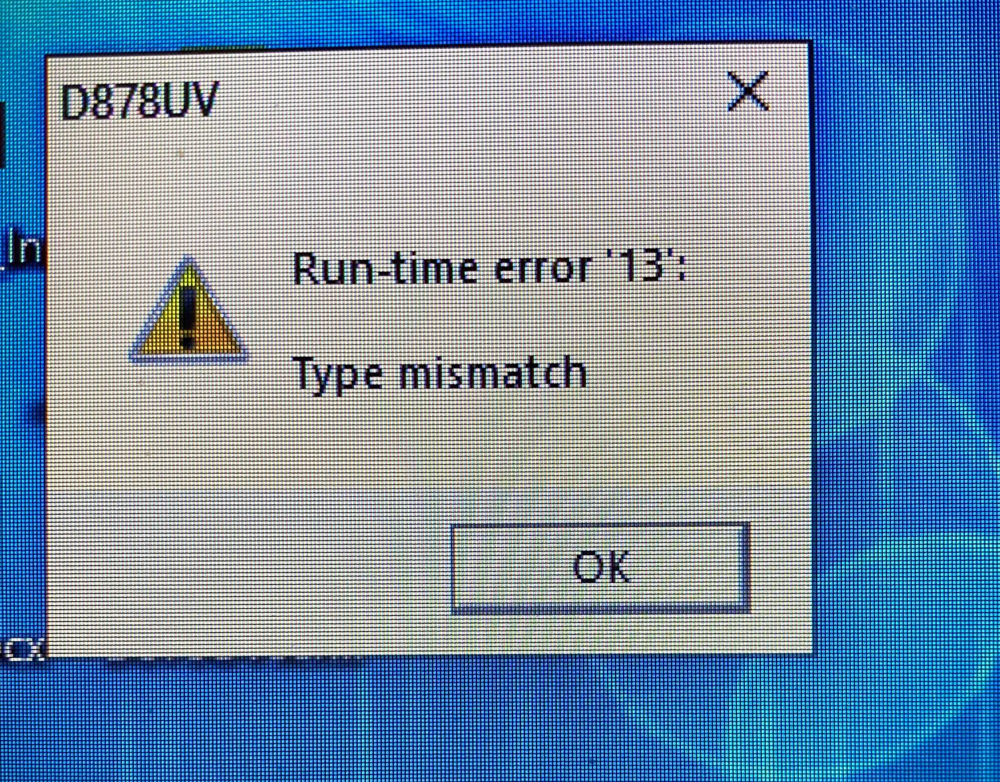

# Run-Time error 13

!!! info "Source"
    Originally published by Norman Williams on hamradiosouthernrepeaters.co.uk. [Original PDF](../originals/images/Anytone/Run-Time_error_13.pdf) · [Source](https://hamradiosouthernrepeaters.co.uk/images/Anytone/Run-Time_error_13.pdf) Hub item 106.

Have you any off the below software install -

1. [Null-modem emulator](https://www.google.com/search?client=firefox-b-d&q=Null-modem+emulator)
2. [Virtual Serial Port Driver](https://www.google.com/search?client=firefox-b-d&q=Virtual+Serial+Port+Driver)

Uninstall the above software from your PC.

Anytone Engineer said "Run-Time error '13': Type mismatch" means the codeplug has some wrong data type, means the data request to input number, but it was incorrectly input characters.
