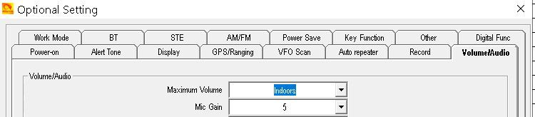

# Volume too Loud

!!! info "Source"
    Originally published by Norman Williams on hamradiosouthernrepeaters.co.uk. [Original PDF](../originals/images/Anytone/Volume_to_Loud.pdf) · [Source](https://hamradiosouthernrepeaters.co.uk/images/Anytone/Volume_to_Loud.pdf) Hub item 137.

**CPS → Optional Settings → Volume/Audio**

**Set to INDOORS**

*Volume/Audio: Maximum Volume = Indoors, Mic Gain = 5.*
