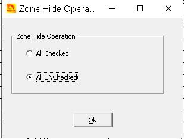

# Zone UP DOWN not working

!!! info "Source"
    Originally published by Norman Williams on hamradiosouthernrepeaters.co.uk. [Original PDF](../originals/images/Anytone/Zone_UP_DOWN_not_working.pdf) · [Source](https://hamradiosouthernrepeaters.co.uk/images/Anytone/Zone_UP_DOWN_not_working.pdf) Hub item 40.

I have the 878UV and i can not scroll through the zones using the centre control (up and down arrows).  I saw a post about this issue but can not find it. Can anyone assist as to why this is happening?

**CPS → Tool → Zone hide Operation:**

*Zone Hide Operation: All UNChecked selected.*

**CLICK ON** = All UNchecked

**YOU MUST CLICK** = OK
